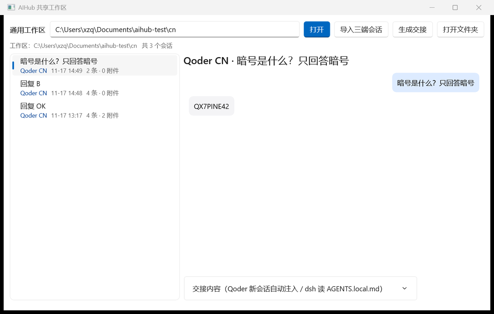

<p align="center">
  
</p>

<h1 align="center">AIHub</h1>

<p align="center">让 Qoder、Qoder CN、DeepSeek Harness 三个本地 AI 客户端共用同一个工作区，对话可以「A 端聊到一半，B/C 端继续」。</p>

<p align="center">
  
</p>

## 它解决什么问题

Qoder（国际版）、Qoder CN、DeepSeek Harness（dsh）各自把会话存放在自己的目录里，彼此看不见。把三个客户端都指向同一个项目工作区后，它们依然只看得见自己的历史。

AIHub 在该工作区建立一份共享档案（`<工作区>/.aihub/hub`）：

- 自动导入三个客户端在此工作区下的全部会话（含附图）；
- 在应用里直接浏览、检索、预览对话和图片；
- 生成「交接文档」`handoff.md`，并同步写入 `AGENTS.local.md`，dsh 会自动读取；
- 配合 Qoder 的 Hooks，新开会话时把交接内容自动注入上下文，实现真正的无缝接力。

全部数据都在本地文件系统，无云端、无账号。

## 安装

从 [Releases](https://github.com/kkt446/AIHub/releases) 下载 `AIHubSetup-x.y.z.exe` 运行即可。

- 安装到当前用户目录（`%LOCALAPPDATA%\Programs\AIHub`），无需管理员权限；
- 自带 .NET 8 运行时与 Windows App SDK，无需预装任何组件；
- 支持 Windows 10 1809+ / Windows 11（x64）。

## 快速开始

1. 启动 AIHub，在顶部选择（或输入）一个通用工作区，例如 `D:\Workspace\AIHub-ws`；
2. 让三个客户端都在这个目录下打开会话；
3. 点击「导入三端会话」，左侧即可看到三端的全部历史；
4. 点击「生成交接」，把 `handoff.md` 写入工作区，并把摘要同步进 `AGENTS.local.md`。

新会话开始时，任何一端的 AI 都能通过交接文档知道别人聊到了哪里。

## 接入 Hooks（实现自动接力）

在**工作区**的 `.qoder/settings.json` 中注册命令（Qoder 会以工作区级配置读取）：

```json
{
  "hooks": {
    "SessionStart": [
      {
        "hooks": [
          {
            "type": "command",
            "command": "\"%LOCALAPPDATA%\\Programs\\AIHub\\aihub.exe\" hook-session-start --workspace \"D:/Workspace/AIHub-ws\"",
            "timeout": 20
          }
        ]
      }
    ],
    "Stop": [
      {
        "hooks": [
          {
            "type": "command",
            "command": "\"%LOCALAPPDATA%\\Programs\\AIHub\\aihub.exe\" hook-stop --workspace \"D:/Workspace/AIHub-ws\"",
            "timeout": 30
          }
        ]
      }
    ]
  }
}
```

- `SessionStart` 会导入最新会话，并把交接摘要通过 `hookSpecificOutput.additionalContext` 注入新会话；
- `Stop` 会在每轮回答结束后导入并刷新交接文档。
- dsh 无需 hooks：应用生成的 `AGENTS.local.md` 位于工作区根目录，dsh 会像读取 `AGENTS.md` 一样加载它。

## 命令行

安装目录下的 `aihub.exe` 也可单独使用：

```text
aihub import   --workspace <dir>    # 导入三端会话并刷新交接
aihub handoff  --workspace <dir>    # 输出交接文档
aihub list     --workspace <dir>    # 列出已归档会话
aihub hook-session-start            # Qoder SessionStart hook 入口（stdin 读取事件）
aihub hook-stop                     # Qoder Stop hook 入口
```

## 数据布局

```text
<工作区>/
├── .aihub/
│   ├── hub/sessions/<client>_<sessionId>/
│   │   ├── session.json         # 元数据
│   │   ├── messages.jsonl       # 消息
│   │   ├── attachments/         # 附图
│   │   └── transcript.md        # 可读全文
│   └── handoff.md               # 交接文档
├── AGENTS.local.md              # 供 dsh 读取的交接摘要（自动生成）
└── .qoder/settings.json         # 可选：Qoder Hooks 配置
```

## 从源码构建

需要 .NET 8 SDK（Windows）与 VS Build Tools 中的 Windows SDK。

```powershell
# 应用（自包含 WinUI 3）
dotnet publish src\AIHub.App\AIHub.App.csproj -c Release -r win-x64 --self-contained true `
  -p:EnableCoreMrtTooling=false -p:WindowsAppSDKSelfContained=true -o dist\app

# CLI（单文件）
dotnet publish src\AIHub.Cli\AIHub.Cli.csproj -c Release -r win-x64 --self-contained true `
  -p:PublishSingleFile=true -p:EnableCompressionInSingleFile=true -o dist\cli

# 安装包（Inno Setup 6）
ISCC.exe src\AIHub.App\installer\AIHub.iss
```

仓库中的构建脚本通过 NuGet 包 `Microsoft.Windows.SDK.BuildTools` 自带 `makepri.exe` 生成 `resources.pri`，因此不依赖 Visual Studio 的 UWP/MSIX 工具链。

## 已知限制

- 会话导入为「快照式」：点击导入或触发 hook 时刷新，尚非文件监听实时同步；
- 应用内暂不支持新建会话/直接发消息（请在客户端中操作）；
- Qoder 的 Hooks 配置按工作区生效，需为每个工作区分别配置。

## License

[MIT](LICENSE)
